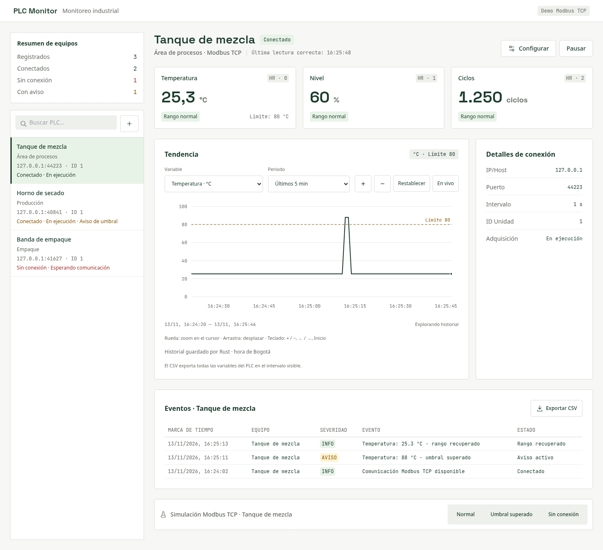
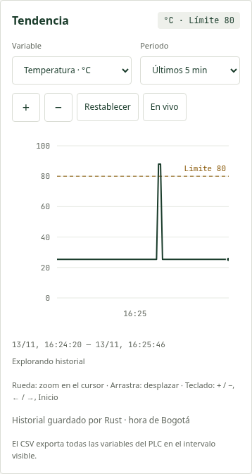
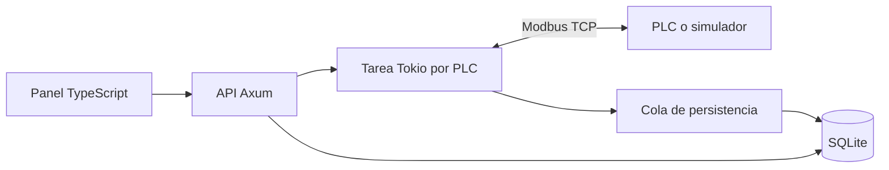

# PLC Monitor

**Monitoreo de múltiples PLC con Rust y Modbus TCP.**

Consulta variables en segundo plano, conserva su historial y revisa avisos, eventos y tendencias desde un panel web. Incluye tres simuladores para ejecutar la demostración sin hardware físico.

**Rust · Tokio · Axum · SQLite · TypeScript · Vite**

[](https://github.com/emanuelvanegas/plc-monitor/actions/workflows/checks.yml)



<details>
<summary>Ver la gráfica en móvil</summary>



</details>

[Inicio rápido](#inicio-rápido) · [Desarrollo](#desarrollo) · [Pruebas](#pruebas) · [Resultados](#prueba-de-una-hora) · [Referencia técnica](docs/REFERENCIA.md)

## Qué hace

- **Varios PLC:** configuración y adquisición independientes, pausa, timeouts y reconexión automática.
- **Variables configurables:** registros holding y de entrada, `uint16`, `int16`, `float32`, escala, unidad y límite alto.
- **Una tendencia a la vez:** selector de variable, zoom fluido con la rueda, desplazamiento y periodos de hasta 24 horas.
- **Calidad visible:** identifica datos desactualizados y deja huecos cuando una lectura falla.
- **Historial persistente:** SQLite, eventos de aviso y recuperación, y CSV del intervalo visible.
- **Demo por TCP:** tanque de mezcla, horno y banda de empaque con escenarios de fallo controlados.

## Inicio rápido

Requisitos: Rust **1.99.1** mediante rustup, Node.js **26** —la versión usada en CI— y un compilador C para SQLite. Las dependencias están fijadas en los archivos de bloqueo.

Clona el repositorio y ejecuta la demo:

```bash
git clone https://github.com/emanuelvanegas/plc-monitor.git
cd plc-monitor
npm --prefix frontend ci
npm --prefix frontend run build
cargo run --locked -- --demo
```

Abre **http://127.0.0.1:8080**. Rust sirve la API y el panel compilado. La configuración y el historial se guardan en `data/plc-monitor.db`.

Si tu terminal no encuentra `cargo`, carga primero `source "$HOME/.cargo/env"`.

**Recorrido de la demo:** selecciona un PLC, cambia la variable de la gráfica, activa **Sin conexión**, espera la lectura fallida y pulsa **Normal** para observar la recuperación. Los otros PLC siguen leyendo. Puedes pausar un equipo y exportar su historial con **Exportar CSV**.

Para consultar tus equipos configurados, inicia sin `--demo`:

```bash
cargo run --locked
```

## Desarrollo

Backend, en una terminal:

```bash
cargo run --locked -- --demo --listen 127.0.0.1:8080
```

Frontend con recarga automática, en otra terminal:

```bash
npm --prefix frontend run dev
```

Abre **http://127.0.0.1:5173**. El proxy de Vite envía `/api` al backend del puerto **8080**.

## Pruebas

**29 pruebas automatizadas**, además de las mediciones de cadencia y la prueba prolongada.

| Suite | Casos | Qué comprueba |
|---|---:|---|
| [Unitarias Rust](src/domain.rs) y [temporizador](src/schedule.rs) | 7 | Conversión, validación, umbrales, cadencia y reconexión con reloj controlado |
| [Integración TCP/API/SQLite](tests/system.rs) y [lecturas lentas](tests/cadence.rs) | 6 | Comunicación real con simuladores, aislamiento, timeout, persistencia, CSV y resumen del historial |
| [Navegador](frontend/tests) | 14 | Configuración, recuperación, gráficas, zoom, selección de variables, exportación y móvil |
| [Validadores Python](scripts/test_soak_test.py) | 2 | Calidad del CSV, pausa y aislamiento en el informe prolongado |

Última verificación local: **13 de noviembre de 2026**. [Resultados y comandos completos](docs/PRUEBAS.md).

Con las dependencias del frontend instaladas:

```bash
cargo test --locked
cargo build --locked
npm --prefix frontend run build
npm --prefix frontend exec -- playwright install chromium
npm --prefix frontend run test:e2e
python3 -m unittest discover -s scripts -p 'test_soak_test.py' -v
```

Para explorar el reporte HTML de las pruebas de navegador:

```bash
npm --prefix frontend run test:report
```

El [workflow de GitHub Actions](.github/workflows/checks.yml) ejecuta formato, Clippy, compilación y las tres suites. También guarda el reporte de Playwright como artefacto. Consulta las [ejecuciones de Checks](https://github.com/emanuelvanegas/plc-monitor/actions/workflows/checks.yml) para ver su estado en GitHub.

## Prueba de una hora

Validación del **12 de noviembre de 2026**, con tres PLC simulados, nueve variables e intervalo de un segundo, usando el ejecutable `release`.

| Medida | Resultado |
|---|---:|
| Estado | `passed` |
| Duración medida | 3.600 s |
| Muestras guardadas | 29.421 |
| RSS inicial → final | 10,23 → 10,27 MiB |
| RSS máxima observada | 11,73 MiB |
| CPU media, respecto a un núcleo | 0,278 % |

Se verificaron ocho acciones de aviso, fallo, pausa y recuperación. Las 273 muestras fallidas corresponden a los fallos provocados; los CSV coincidieron con SQLite y los tres equipos terminaron recuperados.

[Resultados y evidencia](docs/RESULTADO_PRUEBA_1H.md) · [Reproducir la prueba](docs/PRUEBA_PROLONGADA.md) · [Comparación de cadencia](docs/CADENCIA.md)

## Arquitectura



Cada PLC conserva su conexión y calendario de sondeo. Las lecturas del mismo equipo se ejecutan en secuencia; `interval` con `Skip` evita acumular todos los ticks atrasados. Las muestras conservan valor, unidad, fecha y calidad, y la adquisición continúa aunque se cierre el navegador.

## Alcance

Versión **0.1.0**, orientada a monitoreo local y lectura de registros. La validación disponible utiliza simuladores Modbus TCP. Quedan pendientes la medición de capacidad y las pruebas con un PLC físico; el [roadmap](docs/ROADMAP.md) recoge el trabajo siguiente.

Consulta la [referencia técnica](docs/REFERENCIA.md) para mapas de registros, límites, retención y API.

## Licencia

[MIT](LICENSE). Las licencias de las fuentes están incluidas en [frontend/public/licenses](frontend/public/licenses).
